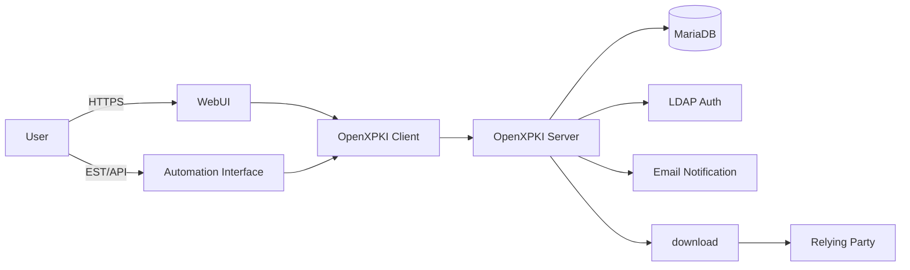
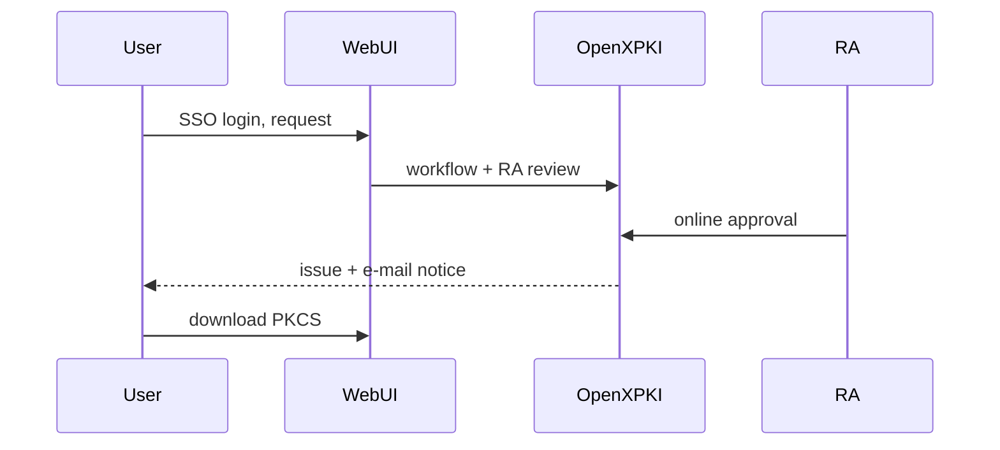
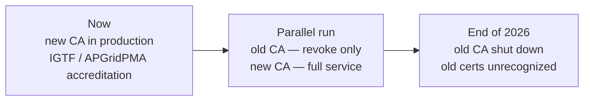

### The Upgrade and Modernization of the IHEP Grid Certification Authority

#### <mdi-certificate /> OpenXPKI · Automated Certificate Lifecycle · Trust for Chinese HEP Computing

<br>

##### **Xiao Han · on behalf of Grid Group, IHEP Computing Center** <a href="mailto:hanx@ihep.ac.cn"></a><Email v="hanx@ihep.ac.cn" />

<br>

##### October 28 – November 1, 2026 · Wuhan

<br>

<a href="https://indico.ihep.ac.cn/event/29795/" class="ns-c-iconlink"><mdi-open-in-new />The 12th China LHC Physics Conference (CLHCP2026)</a>, <a href="https://gridca.ihep.ac.cn/webui/ihepca/" class="ns-c-iconlink"><mdi-open-in-new />gridca.ihep.ac.cn</a>


---
layout: side-title
title: Table of Contents
color: rose-light
align: cm-lm
---

:: title ::

# Outline

:: content ::

- **Grid PKI and Its Role**
    - *What a CA does · who relies on it*
- **The Old System and Its Limits**
- **The New CA on OpenXPKI**
    - *Architecture · user experience · automation*
- **Trust and Migration**
- **Summary**

---
layout: section
color: cyan-light
---

# 1 · Grid PKI and Its Role

---
layout: top-title
color: gray-light
---

:: title ::

# Certificates are identities for distributed computing

:: content ::

<AdmonitionType type='info'>
<mdi-certificate /> A <b>C</b>ertificate <b>A</b>uthority is the trusted entity that issues and manages X.509 digital certificates — the machine-readable identities of a distributed computing infrastructure.
</AdmonitionType>

**How grid access works:**

```text
User ── certificate (issued by IHEP CA, ~1 year)
     ── VOMS proxy (short-lived credential, hours)
     ── grid jobs, storage, services
```

**The relying side:**

- Sites and services verify the certificate chain → **the CA vouches for the identity**
- VOMS maps the certificate to experiment roles (e.g. `/atlas`, `/belle`)
- Lost trust in the CA ⇒ the whole authentication chain fails

---
layout: top-title
color: gray-light
---

:: title ::

# Who relies on the IHEP CA

:: content ::

<div class="who-grid mt-4">
  <div><strong><mdi-atom /> LHC experiments</strong><span> Chinese ATLAS, CMS and LHCb groups: user certificates, robot certificates, host certificates for sites and services in the WLCG framework.</span></div>
  <div><strong><mdi-flask /> Domestic experiments</strong><span> JUNO, Belle II, LHAASO and others: grid computing identity for production, analysis and data transfer.</span></div>
  <div><strong><mdi-earth /> International trust</strong><span> As part of the IGTF / APGridPMA trust framework, IHEP-issued identities are recognized by WLCG sites worldwide.</span></div>
</div>

<AdmonitionType type='important'>
The IHEP CA is <b>shared national infrastructure</b>: one trust anchor behind the distributed computing of essentially every HEP collaboration in China — including future experiments such as CEPC.
</AdmonitionType>

---
layout: section
color: red-light
---

# 2 · The Old System and Its Limits

---
layout: top-title-two-cols
color: gray-light
---

:: title ::

# An aged OpenCA deployment

:: left ::

<div style="text-align: center; max-width: 100%; margin: 0 auto;">
  
  <div style="font-size:0.8em;color:#888;margin-top:4px;"><mdi-web /> cagrid.ihep.ac.cn — the old CA web interface</div>
</div>

:: right ::

| Issue | Impact |
|---|---|
| Root key **1024-bit** | Below modern security requirements |
| Framework **OpenCA** | Community abandoned for years |
| **Offline** issuance | Admin physically enters an isolated room |
| **Manual** CRL | Delayed publication after revocation |

<AdmonitionType type='warning'>
Growing user base + rising automation needs: the old system could not scale <b>securely</b> or <b>efficiently</b>.
</AdmonitionType>

---
layout: section
color: purple-light
---

# 3 · The New CA on OpenXPKI

---
layout: top-title
color: gray-light
---

:: title ::

# OpenXPKI: an enterprise-grade PKI platform

:: content ::

<mdi-server-network /> **OpenXPKI** — open-source trustcenter software for X.509 certificate lifecycle management, established 2009, Apache 2.0.

**Why it fits our requirements:**

- Workflow-driven lifecycle — request, approval, issuance, revocation
- Multi-protocol enrollment — **EST · SCEP · ACME** · REST API
- Flexible crypto layer — HSM via PKCS#11, OpenSSL backend
- Multi-tenant PKI realms with seamless CA rollover
- YAML-based configuration — auditable and version-controlled
- Authentication — LDAP / SSO · password · client certificate


---
layout: top-title
color: gray-light
---

:: title ::

# Architecture

:: content ::

<div style="text-align: center; max-width: 88%; margin: 0 auto;">



</div>

<div class="text-center mt-2">
<b>Layers:</b> user → access (WebUI / EST / API) → business logic (workflow, RA) → data → publishing (certificates, CRL)
</div>

---
layout: top-title-two-cols
color: gray-light
---

:: title ::

# What changed for the user

:: left ::

| Dimension | Old (OpenCA) | New (OpenXPKI) |
|---|---|---|
| URL | cagrid.ihep.ac.cn | **gridca.ihep.ac.cn** |
| Login | Basic web form | **IHEP SSO** |
| Approval | Offline e-mail | **Online RA workflow** |
| Key generation | Browser-dependent | **Server-side, RSA 4096** |
| Automation | None | **EST · API** |
| CRL | Manual | **Automatic** |

:: right ::

**Request → issue, fully online:**



<AdmonitionType type='note'>
From "days, with human relay" to "same-day, self-service".
</AdmonitionType>

---
layout: top-title-two-cols
color: gray-light
align: c-lt-lt
---

:: title ::

# The new WebUI: gridca.ihep.ac.cn

:: left ::

<AdmonitionType type='info'>
<mdi-web /> A public landing page explains the service, trust and history — before asking for any credentials.
</AdmonitionType>

**Four authentication entries:**

- **IHEP Account (SSO)** — recommended for all users
- **Client certificate** — returning certificate holders
- **Client certificate (RA)** — RA operators
- **IHEP-2013 certificate migration** — one-time identity carry-over

**Also public:** CA certificates, CRLs and policy documents for relying parties.

:: right ::

<div style="text-align: center;">
  
  <div style="font-size:0.8em;color:#888;margin-top:6px;"><mdi-web /> gridca.ihep.ac.cn — the new CA web interface</div>
</div>

---
layout: top-title
color: gray-light
---

:: title ::

# Automation beyond the WebUI

:: content ::

<div class="cap-grid mt-4">
  <div><mdi-refresh-auto /><div><strong>EST auto-renewal for hosts</strong><span>Host certificates renew themselves within 45 days of expiry — no operator action, no expired service certificates.</span></div></div>
  <div><mdi-swap-horizontal /><div><strong>Legacy host migration</strong><span>The same script migrates IHEP-2013 host certificates to the new CA via mTLS, one time per hostname.</span></div></div>
  <div><mdi-file-certificate-outline /><div><strong>Automatic CRL</strong><span>Revocation lists are generated and published automatically — relying parties see revocations without delay.</span></div></div>
  <div><mdi-bell-ring-outline /><div><strong>Lifecycle notifications</strong><span>Approval, issuance, rejection and expiry reminders reach users and RA by e-mail, automatically.</span></div></div>
</div>

<AdmonitionType type='info'>
Robot certificates cover non-human identities — pilots, production automation — each with a responsible person, managed through the same workflow.
</AdmonitionType>

---
layout: section
color: orange-light
---

# 4 · Trust and Migration

---
layout: top-title
color: gray-light
---

:: title ::

# Accreditation and migration timeline

:: content ::

<div style="text-align: center; max-width: 92%; margin: 0 auto;">



</div>

**Two migration paths:**

- **New users / expired certificates** — SSO login → online request → RA approval → download
- **Valid IHEP-2013 holders** — dedicated online migration entry, once per account

<AdmonitionType type='important'>
After the old CA retires at the <b>end of 2026</b>, certificates it issued will no longer be recognized by grid services — migration is not optional.
</AdmonitionType>

---
layout: top-title
color: gray-light
---

:: title ::

# Summary

:: content ::

- **Modern platform** — OpenCA → OpenXPKI: a maintained, workflow-driven, enterprise-grade PKI
- **Stronger security** — 1024-bit root retired; RSA 4096 server-side key generation; automated CRL
- **Better service** — SSO login, online RA approval, same-day issuance, e-mail notifications
- **Automation** — EST renewal for hosts, legacy migration, API access for bulk integration
- **Trust continuity** — IGTF / APGridPMA accreditation; parallel run; old CA retires end of 2026
- **Shared foundation** — one trust anchor for LHC, JUNO, Belle II, LHAASO… and CEPC

<AdmonitionType type='note'>
<mdi-certificate /> Documentation and user guides are published with the CA; user training is provided at collaboration workshops and winter schools.
</AdmonitionType>

---
layout: cover
color: navy
title: Questions
---


### Thank you. Questions?

**Xiao Han · IHEP, CC**<br/>
Grid Group · PKI Team

<a href="https://gridca.ihep.ac.cn/webui/ihepca/" class="ns-c-iconlink"><mdi-open-in-new /> gridca.ihep.ac.cn</a>
 · <a href="https://indico.ihep.ac.cn/event/29795/" class="ns-c-iconlink"><mdi-calendar /> CLHCP2026</a>

<br/>

##### Acknowledgements: IGTF · APGridPMA · EUGridPMA — and the IHEP PKI team: Gongxing Sun (RA), Tian Yan, Xiao Han
