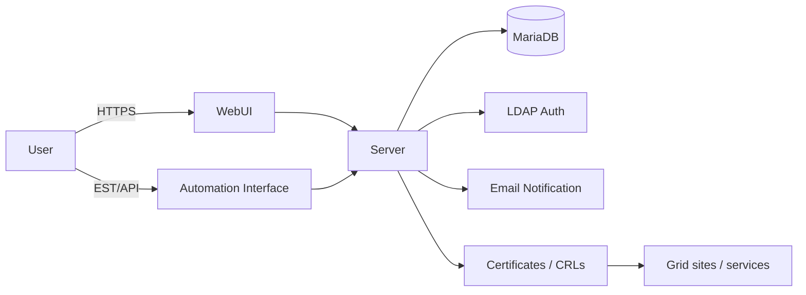
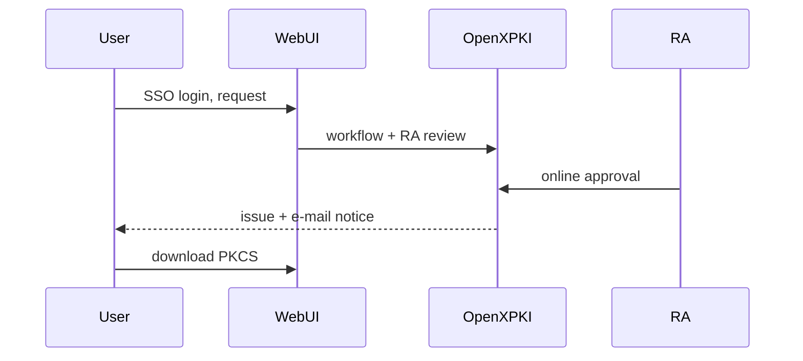

### The Upgrade of the China Grid Certification Authority

#### <mdi-certificate /> OpenXPKI · Automated Certificate Lifecycle · Trust for Chinese HEP Computing

 

##### **Xiao Han · on behalf of Grid Group, IHEP Computing Center** <Email v="hanx@ihep.ac.cn" />

 

##### November 1, 2026 · Wuhan

 

<a href="https://indico.ihep.ac.cn/event/29795/" class="ns-c-iconlink"><mdi-open-in-new />The 12th China LHC Physics Conference (CLHCP2026)</a>, <a href="https://gridca.ihep.ac.cn/webui/ihepca/" class="ns-c-iconlink"><mdi-open-in-new />gridca.ihep.ac.cn</a>

<!--
Timing: 0:30

Good afternoon. I am Xiao Han from the IHEP Computing Center. Users know our grid certificate service as IHEP CA. Today I will present the upgrade of the PKI infrastructure behind that service, explaining its role in distributed computing, the limits of the old system, and the improvements in the new deployment.
-->

---
layout: side-title
title: Table of Contents
color: rose-light
align: cm-lm
---

:: title ::

# Outline

:: content ::

- **Grid PKI and Its Role**
    - *What a CA does · who relies on it*
- **The Old System and Its Limits**
- **The New CA on OpenXPKI**
    - *Architecture · user experience · automation*
- **Trust and Migration**
- **Summary**

---
layout: section
color: cyan-light
---

# 1 · Grid PKI and Its Role

---
layout: top-title
color: gray-light
---

:: title ::

# A trust infrastructure for grid computing

:: content ::

IHEP operates a complete <strong>Public Key Infrastructure (PKI)</strong>: the trust system used to issue, manage and validate digital certificates for HEP computing.

  
PKI system deployed at IHEP

  

    

      <strong>Identity checks</strong>
      Verify the identities of users and service owners.
    

    
<svg viewBox="0 0 24 24" fill="none" stroke="currentColor" stroke-width="1.8" stroke-linecap="round" stroke-linejoin="round"><path d="M4 12h16m-6-6 6 6-6 6" /></svg>

    

      <strong>IHEP CA</strong>
      Certification Authority
      Signs X.509 certificates binding verified identities to public keys.
    

    
<svg viewBox="0 0 24 24" fill="none" stroke="currentColor" stroke-width="1.8" stroke-linecap="round" stroke-linejoin="round"><path d="M4 12h16m-6-6 6 6-6 6" /></svg>

    

      <strong>Lifecycle services</strong>
      Renew certificates; publish revocation and status information.
    

  

  
<strong>Researchers &amp; grid jobs</strong>User and robot certificates identify researchers and automated tasks.

  
<strong>Services &amp; data</strong>Host certificates support authenticated connections to grid services.

  
<strong>Cross-site trust</strong>IGTF trust distribution supports authentication across participating sites.

<strong>Lost trust in the CA ⇒ the whole authentication chain fails.</strong>

<!--
Timing: 1:00

Our infrastructure provides the trusted digital identities needed by distributed physics computing. IHEP runs the complete PKI system: policies, identity checks, certificate issuance, lifecycle management and trust information. Within this system, the CA signs certificates that bind a verified identity to a public key. Researchers and automated tasks use user and robot certificates; host certificates identify service endpoints. IGTF distributes the trust anchors so participating sites can authenticate these identities. This supports job submission and data access across sites. Authentication establishes identity; experiment and site policies still decide access rights. The next slide shows which experiments use this service.
-->

---
layout: top-title
color: gray-light
---

:: title ::

# Who relies on the IHEP CA

:: content ::

  
<strong><mdi-atom /> LHC experiments</strong> Chinese ATLAS, CMS, ALICE and LHCb groups: user certificates, robot certificates, host certificates for sites and services in the WLCG framework.

  
<strong><mdi-flask /> Non-LHC experiments</strong> JUNO, HERD, Belle II and others: grid computing identity for production, analysis and data transfer; formerly also BESIII.

  
<strong><mdi-earth /> International trust</strong> As part of the IGTF / APGridPMA trust framework, IHEP-issued identities are recognized by WLCG sites worldwide.

<AdmonitionType type='important'>
The IHEP CA is <b>shared national infrastructure</b>: one trust anchor behind the distributed computing of essentially every HEP collaboration in China — including future experiments such as CEPC.
</AdmonitionType>

  <figure><figcaption>ATLAS</figcaption></figure>
  <figure><figcaption>CMS</figcaption></figure>
  <figure><figcaption>ALICE</figcaption></figure>
  <figure><figcaption>LHCb</figcaption></figure>
  <figure><figcaption>JUNO</figcaption></figure>
  <figure><figcaption>HERD</figcaption></figure>
  <figure><figcaption>Belle II</figcaption></figure>
  <figure><figcaption>BESIII · former</figcaption></figure>
  <figure><figcaption>CEPC · future</figcaption></figure>

---
layout: section
color: red-light
---

# 2 · The Old System and Its Limits

---
layout: top-title-two-cols
color: gray-light
---

:: title ::

# An aged OpenCA deployment

:: left ::

  
<strong>2004</strong>Operations began; initially accredited by EUGridPMA, later transitioning to APGridPMA.

  
<strong>2013</strong>IHEP-2013 root entered service: SHA-1 with a 1024-bit RSA key.

  
<strong>2026</strong>New online PKI and certificate hierarchy: IHEP-2026-ROOT and IHEP-2026-ICA.

<figure class="legacy-ca-figure">
  
  <figcaption><mdi-web /> cagrid.ihep.ac.cn · legacy interface History: <a href="https://gridca.ihep.ac.cn/webui/ihepca/">official IHEP CA website</a></figcaption>
</figure>

:: right ::

| Issue | Impact |
|---|---|
| Root key **1024-bit** | Below modern security requirements |
| Framework **OpenCA** | Community abandoned for years |
| **Offline** issuance | Admin physically enters an isolated room |
| **Manual** CRL | Delayed publication after revocation |

<AdmonitionType type='warning'>
Growing user base + rising automation needs: the old system could not scale <b>securely</b> or <b>efficiently</b>.
</AdmonitionType>

<!--
Timing: 0:55

The public IHEP CA homepage records the history: operations started in 2004 with EUGridPMA accreditation and later transitioned to APGridPMA. The IHEP-2013 root entered service in 2013 using SHA-1 and a 1024-bit RSA key. In 2026 the CA introduced a new root and issuing CA hierarchy alongside the online PKI system. The screenshot shows the legacy interface; the table explains why the old deployment needed replacing.
-->

---
layout: section
color: purple-light
---

# 3 · The New CA on OpenXPKI

---
layout: top-title
color: gray-light
---

:: title ::

# System development

:: content ::

We built our PKI on open-source <strong>OpenXPKI</strong>, adding IHEP-specific workflows, integrations and operations.

| Repository | Commits | Files | Added lines | IHEP development |
|---|---:|---:|---:|---|
| **openxpki-config** | 85 | 149 | **+7,089** | Workflows, authentication, profiles, WebUI |
| **openxpki-docker** | 41 | 20 | **+2,734** | Deployment, scripts and documentation |
| **monitoring** | 16 | 13 | **+643** | PKI health checks, logs and retention |
| **openxpki-rpm** | 1 | 25 | **+1,149** | RPM specs, container builds and patches |

Prelaunch snapshot; excludes generated WebUI assets and CPAN dependency lockfiles (~18k lines).

  
<mdi-code-braces />
<strong>Source-level patches</strong>8 Perl modules · +1,470 lines in authentication, issuance and migration.

  
<mdi-file-cog-outline />
<strong>YAML workflows &amp; profiles</strong>68 files · +4,284 lines for workflows, notifications and EST.

  
<mdi-docker />
<strong>Deployment &amp; operations</strong>Compose customization + 10 scripts for CRLs, renewal and reminders.

  
<mdi-monitor-dashboard />
<strong>Monitoring &amp; packaging</strong>Dedicated repositories for PKI monitoring and RPM builds.

<!--
Timing: 0:45

OpenXPKI is our maintained open-source foundation. On top of it, we developed and integrated the IHEP PKI: local identity integration, approval workflows, legacy migration, lifecycle automation and operational tooling. The table shows the scope of that development, with the changes kept under version control. The next slide presents the capabilities delivered by our system, rather than a list of upstream OpenXPKI features.

Reference: the figures are the snapshot recorded in the prelaunch report, not a new repository recount. The openxpki-config baseline is 0b140fd and the openxpki-docker baseline is c0b9286; monitoring and openxpki-rpm are counted from repository creation. Generated WebUI assets and CPAN dependency lockfiles, approximately 18,000 lines, are excluded. The Perl and YAML figures are subsets of the repository figures, not additional lines to add to them.
-->

---
layout: top-title
color: gray-light
---

:: title ::

# System features

:: content ::

Our deployed PKI provides online certificate services for users, hosts and RA operators.

  
<mdi-account-key />
<strong>Online request, automatic issuance</strong> IHEP-account login, online request for user / robot / host certificates; server-side RSA 4096 keys, automatic issuance after RA approval.

  
<mdi-robot-industrial />
<strong>Smooth legacy migration</strong> IHEP-2013 personal certificates migrate in one step, identity locked server-side; legacy hosts migrate via EST — no manual work.

  
<mdi-autorenew />
<strong>EST auto-renewal for hosts</strong> Host-side scripts renew within 45 days of expiry and hot-reload services — a zero-ops lifecycle.

  
<mdi-file-remove-outline />
<strong>Online revocation, automatic CRL</strong> Single or batch revocation online; CRLs issued on schedule and published to public URLs, per the CP/CPS.

  
<mdi-bell-ring-outline />
<strong>Lifecycle e-mail notifications</strong> Pending, issued, rejected and expiring-soon events notify applicants and the RA automatically.

  
<mdi-shield-account />
<strong>RA online workbench</strong> Approval queue, certificate search, workflow tracking, batch approval — all logged and auditable.

<!--
Timing: 0:55

These are the capabilities of the deployed IHEP system. Researchers request certificates through their IHEP account, and the RA reviews and approves them online. We added migration paths for existing users and hosts, automated host renewal and service reloads, online revocation, scheduled CRL publication and lifecycle notifications. Together these form an integrated service for users and operators, built on the development work shown on the preceding slide.
-->

---
layout: top-title
color: gray-light
---

:: title ::

# Architecture

:: content ::

One PKI backend handles approval workflows, certificate issuance and lifecycle management.

<!--
Timing: 0:35

This is a functional view of the deployed system. WebUI and automation requests reach one PKI backend, shown simply as Server. Internal OpenXPKI client and server processes are deliberately combined here. The backend coordinates identity integration, certificate workflows, stored records, notifications and public certificate and CRL distribution. Grid sites use the published trust information when authenticating users and services.
-->

---
layout: top-title-two-cols
color: gray-light
---

:: title ::

# What changed for the user

:: left ::

| Dimension | Old (OpenCA) | New (OpenXPKI) |
|---|---|---|
| URL | cagrid.ihep.ac.cn | **gridca.ihep.ac.cn** |
| Login | Basic web form | **IHEP SSO** |
| Approval | Offline e-mail | **Online RA workflow** |
| Key generation | Browser-dependent | **Server-side, RSA 4096** |
| Automation | None | **EST · API** |
| CRL | Manual | **Automatic** |

:: right ::

**Request → issue, fully online:**

<AdmonitionType type='note'>
From "days, with human relay" to "same-day, self-service".
</AdmonitionType>

---
layout: top-title-two-cols
color: gray-light
align: c-lt-lt
---

:: title ::

# The new WebUI: gridca.ihep.ac.cn

:: left ::

<AdmonitionType type='info'>
<mdi-web /> A public landing page explains the service, trust and history — before asking for any credentials.
</AdmonitionType>

**Four authentication entries:**

- **IHEP Account (SSO)** — recommended for all users
- **Client certificate** — returning certificate holders
- **Client certificate (RA)** — RA operators
- **IHEP-2013 certificate migration** — one-time identity carry-over

**Also public:** CA certificates, CRLs and policy documents for relying parties.

:: right ::

  
  
<mdi-web /> gridca.ihep.ac.cn — the new CA web interface

---
layout: top-title
color: gray-light
---

:: title ::

# Auditable and monitored end to end

:: content ::

  
<mdi-database-search />
<strong>Full audit trail</strong> Every WebUI, RA and EST access and operation is recorded in the database — searchable by person, time and action.

  
<mdi-monitor-dashboard />
<strong>Centralized logs and dashboards</strong> Component logs persist to Elasticsearch; Grafana status, audit and security panels are already in production.

  
<mdi-two-factor-authentication />
<strong>Hardened operations</strong> Server logins require an independent second factor; every login notifies the administrators by e-mail.

  
<mdi-database-sync-outline />
<strong>Backup and recovery</strong> MariaDB dual replicas with scheduled backups of certificate and workflow data — meeting audit and recovery requirements.

<AdmonitionType type='info'>
Every issuance notifies both the RA and the applicant — anomalous issuance becomes visible immediately, strengthening the trust story behind the accreditation.
</AdmonitionType>

---
layout: top-title-two-cols
color: gray-light
align: c-lt-lt
---

:: title ::

# CA monitoring in operation

:: left ::

Three complementary Grafana dashboard views:

- **Status** — container health, certificate issuance and workflow states
- **Audit** — WebUI, RA and EST access and operation records
- **Security** — abnormal logins, policy violations and CRL status

Additional views are under active development.

This recording shows the deployed dashboards, rather than a live connection to the CA system.

:: right ::

<figure class="ca-demo-recording">
  <SlidevVideo :src="'./d4.monitoring.mp4?v=20261030'" :poster="'./d4.monitoring-poster.webp'" width="1264" height="1536" aria-label="Recording of CA monitoring dashboards" autoplay loop muted playsinline controls preload="metadata" />
  <figcaption><mdi-monitor-screenshot /> Recorded CA monitoring · <a :href="'./d4.monitoring.mp4?v=20261030'" target="_blank" rel="noopener noreferrer">Open video</a></figcaption>
</figure>

<!--
Timing: 0:40

The monitoring is operational, not just a design. The three views cover status, audit and security. Let the recording run briefly and point out the relationship between service health and recorded activity. This is a prerecorded view; it does not expose live access to the CA from the presentation.
-->

---
layout: top-title-two-cols
color: gray-light
align: c-lt-lt
---

:: title ::

# A published guide for the full user journey

:: left ::

The CA guide is published in the **IHEP Computing Platform User Manual** and maintained alongside the system.

- **Apply** — user, robot and host certificates
- **Migrate and renew** — IHEP-2013 personal migration and host certificate automation
- **Download and use** — PKCS#12 export, browser installation and command-line conversion

Users have a maintained reference beyond workshop training and individual support.

:: right ::

<figure class="ca-demo-recording">
  <SlidevVideo :src="'./d5.manual.mp4?v=20261030'" :poster="'./d5.manual-poster.webp'" width="1264" height="1536" aria-label="Recording of the online CA user guide" autoplay loop muted playsinline controls preload="metadata" />
  <figcaption><mdi-book-open-variant /> Recorded user guide · <a :href="'./d5.manual.mp4?v=20261030'" target="_blank" rel="noopener noreferrer">Open video</a></figcaption>
</figure>

<!--
Timing: 0:40

The user documentation is already published in the computing platform manual. The recording illustrates how users can follow the complete journey, from choosing a certificate type to migration, download and installation. Keep this overview short: the conference presentation is not a step-by-step training session.
-->

---
layout: section
color: orange-light
---

# 4 · Trust and Migration

---
layout: top-title
color: gray-light
---

:: title ::

# Timeline: development, accreditation, migration

:: content ::

  <section class="ca-timeline-phase ca-timeline-build">
    
2025<strong>Build &amp; deploy</strong>

    <ol class="ca-timeline-events">
      <li><strong class="ca-timeline-date">Early 2025</strong>OpenXPKI-based architecture selected.</li>
      <li><strong class="ca-timeline-date">Mid-2025</strong>Development and testing.</li>
      <li><strong class="ca-timeline-date">Late 2025</strong>CA system deployed.</li>
    </ol>
  </section>
  
<svg viewBox="0 0 24 24" fill="none" stroke="currentColor" stroke-width="1.8" stroke-linecap="round" stroke-linejoin="round"><path d="M4 12h16m-6-6 6 6-6 6" /></svg>

  <section class="ca-timeline-phase ca-timeline-review">
    
February–July 2026<strong>Apply &amp; review</strong>

    <ol class="ca-timeline-events">
      <li><strong class="ca-timeline-date">February 2026</strong>First contact with the APGridPMA chair.</li>
      <li><strong class="ca-timeline-date">March 2026</strong>Formal application submitted at ISGC.</li>
      <li><strong class="ca-timeline-date">April–July 2026</strong>Review and sustained follow-up.</li>
    </ol>
  </section>
  
<svg viewBox="0 0 24 24" fill="none" stroke="currentColor" stroke-width="1.8" stroke-linecap="round" stroke-linejoin="round"><path d="M4 12h16m-6-6 6 6-6 6" /></svg>

  <section class="ca-timeline-phase ca-timeline-migrate">
    
August–December 2026<strong>Accredit &amp; migrate</strong>

    <ol class="ca-timeline-events">
      <li><strong class="ca-timeline-date">August 2026</strong>IHEP-2026 hierarchy included in IGTF 1.145.</li>
      <li><strong class="ca-timeline-date">End of 2026</strong>IHEP-2013 root expires: migration deadline.</li>
    </ol>
  </section>

<AdmonitionType type='warning'>
<b>The end-2026 expiry of the IHEP-2013 root is the hard deadline for this transition.</b> The new CA is accredited and in production; a unified migration notice gives every user a sufficient window to switch.
</AdmonitionType>

<!--
Timing: 0:55

Read each phase from top to bottom, then move to the next column. In early 2025 we selected the OpenXPKI-based architecture. Development and testing followed in the middle of the year, and the system was deployed at the end of 2025. The middle phase covers the initial APGridPMA contact, the formal ISGC application and subsequent review. The IHEP-2026 hierarchy was included in IGTF 1.145 in August 2026. The final milestone is the end-2026 expiry of the IHEP-2013 root, which sets the migration deadline.
-->

---
layout: top-title
color: gray-light
---

:: title ::

# Summary

:: content ::

- **Modern platform** — OpenCA → OpenXPKI: a maintained, workflow-driven, enterprise-grade PKI
- **Stronger security** — 1024-bit root retired; RSA 4096 server-side key generation; automated CRL
- **Better service** — SSO login, online RA approval, same-day issuance, e-mail notifications
- **Automation** — EST renewal for hosts, legacy migration, API access for bulk integration
- **Trust established** — admitted into IGTF 1.145 (Aug 2026); old CA retires at the end of 2026
- **Shared foundation** — LHC, JUNO, HERD and Belle II; formerly BESIII; future support for CEPC

<AdmonitionType type='note'>
<mdi-certificate /> Documentation and user guides are published with the CA; user training is provided at collaboration workshops and winter schools.
</AdmonitionType>

---
layout: cover
color: navy
title: Questions
---

### Thank you. Questions?

**Xiao Han · IHEP, CC** 
Grid Group · PKI Team

<a href="https://gridca.ihep.ac.cn/webui/ihepca/" class="ns-c-iconlink"><mdi-open-in-new /> gridca.ihep.ac.cn</a>
 · <a href="https://indico.ihep.ac.cn/event/29795/" class="ns-c-iconlink"><mdi-calendar /> CLHCP2026</a>

 

##### Acknowledgements: IGTF · APGridPMA · EUGridPMA — and the IHEP PKI team: Gongxing Sun (RA), Tian Yan, Xiao Han
